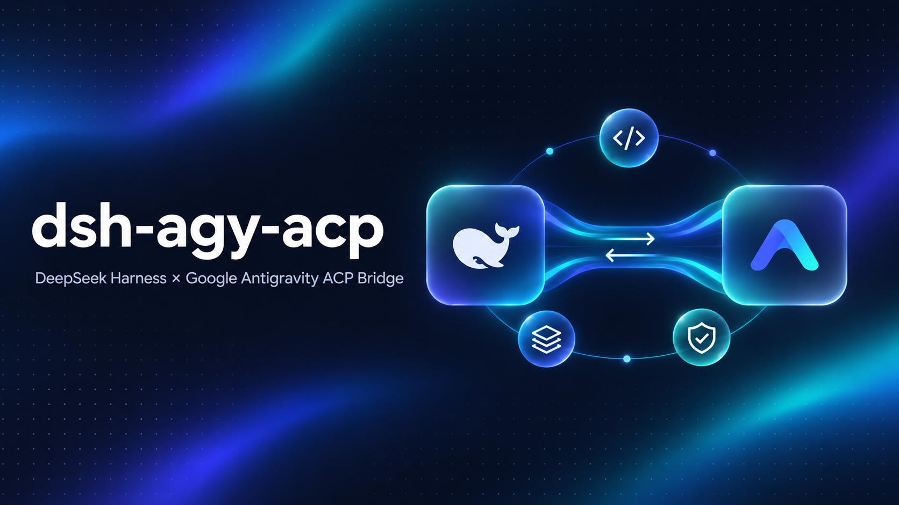
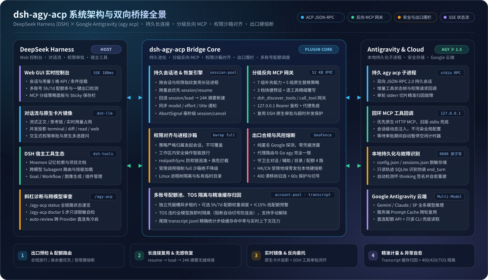
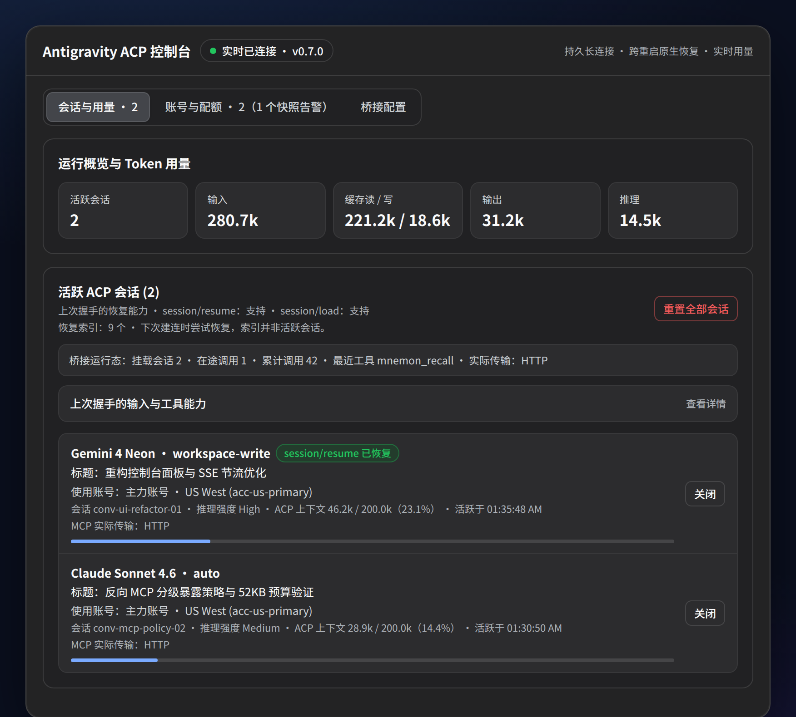
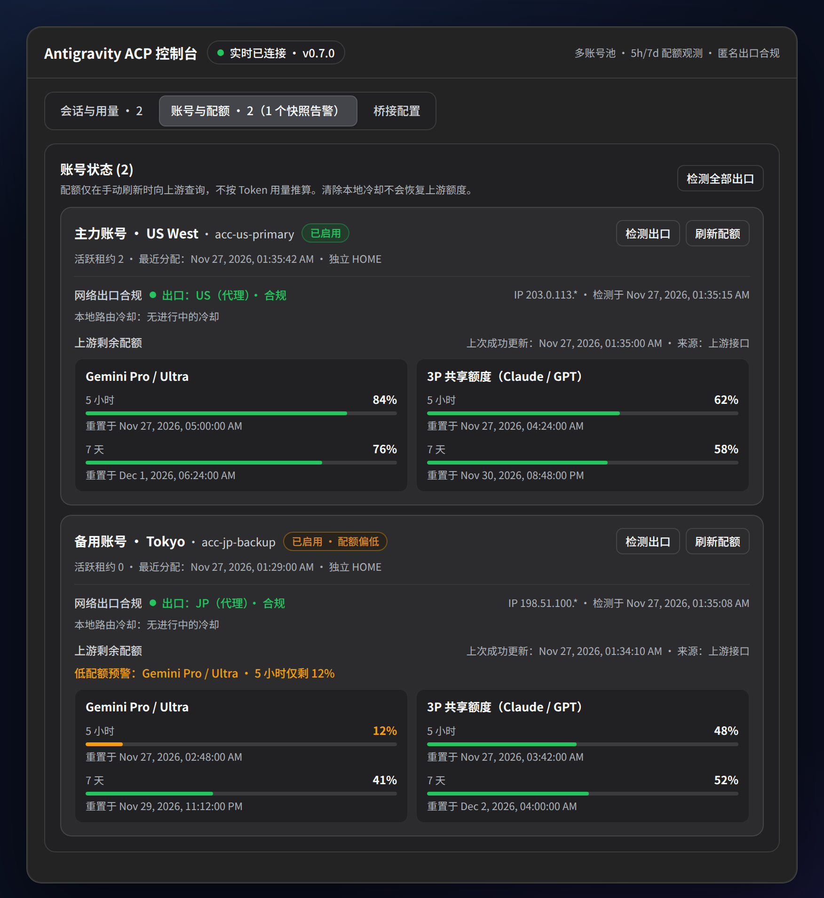
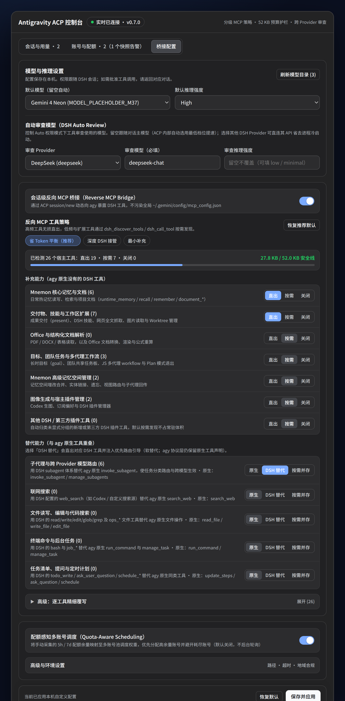

<div align="center">



# dsh-agy-acp

**Persistent DeepSeek Harness (DSH) × Google Antigravity (`agy acp`) Provider Bridge**

**English** · [简体中文](README.zh.md)

[](https://www.npmjs.com/package/@morsewayne/dsh-agy-acp)
[](https://nodejs.org/)
[](#quick-start)
[](package.json)

Persistent ACP JSON-RPC 2.0 Sessions · Tiered Reverse MCP Gateway · Native Chat Tool Cards · Sandbox-Aligned Permissions · Anonymous Egress Geo-Fence · Multi-Account 5h/7d Quota Scheduling

[Quick Start](#quick-start) · [Architecture](#architecture) · [Console Preview](#console-preview) · [Core Capabilities](#core-capabilities) · [Permissions & Security](#permissions--security-invariants) · [Diagnostics](#diagnostics--troubleshooting)

</div>

---

## Why `dsh-agy-acp`

| Area | Highlights |
| --- | --- |
| **Zero-Cold-Start Persistent Sessions** | Pools long-lived `agy acp` child processes keyed by DSH session & permission fingerprint; across idle sweeps and restarts, restores context via `session/resume` → `session/load` → 24K digest rebuild to maximize server-side Prompt Cache retention. |
| **Tiered Reverse MCP Gateway** | Ships **7 supplemental groups + 5 native-replacement groups**, 3 one-click presets, and an on-demand meta-tool gateway (`dsh_discover_tools` / `dsh_call_tool`) guarded by a **52 KB schema budget fuse**, staying comfortably under `agy acp`'s 64 KiB cap while reusing DSH memory, subagents, documents, workflows, and native approvals. |
| **Native Chat Tool Cards & Accurate Cache Metering** | Registers a native DSH `tool.call.toolview` renderer showing `ReadBlock` (clickable file/line links), `DiffBlock` (`+N -M` totals), `TerminalBlock` (cleaned output & exit-code badges), `SearchBlock`, `WebBlock`, and task checklists for both live turns and session replay; tails `transcript.jsonl` to report exact per-step cache hit rate and live context occupancy. |
| **Anonymous Egress Geo-Fence** | Zero third-party IP services — probes anonymous Google endpoints using Go `agy`-aligned proxy routing (`NO_PROXY` / HTTP `CONNECT` / SOCKS5H / TUN). Restricted regions (e.g. `HK` / `CN`) fail closed locally with zero upstream requests, and leaked `400` responses tear down stale connections and failover immediately. |
| **Multi-Account 5h/7d Quota & TOS Quarantine** | Visualizes 5-hour and 7-day quota windows, supports opt-in quota-aware scheduling and ≤15% low-quota alerts, and isolates `TOS_VIOLATION` across all model families while halting automatic failover to prevent cascading account bans. |
| **DSH-Native Console & Access Control** | On-demand SSE listeners with 180ms coalescing, cached tool catalogs, native light/dark `--dsw-alias-*` styling, and full DSH `connection.requestRejection` trust & authentication enforcement across every HTTP and SSE route. |

---

## Architecture

<p align="center">
  
</p>

<details>
<summary>View source module layout</summary>

```text
src/
├── index.ts                  # Plugin entry, authenticated HTTP/SSE mounting, tool catalog cache & lifecycle
├── acp/                      # Persistent agy acp JSON-RPC 2.0 client, process tree & per-turn stderr slicing
├── common/                   # Config schema, tiered MCP tool policy (mcp-tool-policy.ts), geo rules & shared types
├── mcp/                      # Session-scoped loopback HTTP/stdio reverse MCP server & on-demand meta-tool gateway
├── provider/                 # DSH LLM provider adapter, tool mirroring, transcript usage tailing & auto-review router
├── runtime/                  # Session pool, session/resume index, egress geo-fence, multi-account pool, TOS quarantine & doctor
├── transport/                # Throttled SSE broadcaster & DSH-authenticated console REST API
└── client/                   # DSH Web console UI (Sessions & Usage / Accounts & Quota / Config & MCP Policy)
```

</details>

---

## Console Preview

Integrates cleanly into the DSH Web session header pill and Settings panel with full light/dark theme support (`--dsw-alias-*`).

### 1. Sessions & Usage Monitoring
Live view of active sessions, restorable indexes, reverse MCP call metrics, cumulative input/output/cache-hit rates, negotiated ACP capabilities, recovery mode (`session/resume` / `session/load` / new), MCP transport, and context occupancy.

<p align="center">
  
</p>

### 2. Multi-Account Pool, Egress Compliance & 5h/7d Quotas
One-click batch egress check across all enabled accounts, dual 5-hour / 7-day quota bars, ≤15% low-quota alerts, cooldown countdowns, and manual TOS quarantine recovery.

<p align="center">
  
</p>

### 3. Bridge Config, Cross-Provider Auto-Review & Tiered MCP Policy
Layered controls for default model/reasoning effort, cross-provider auto-review routing, **Balanced / DSH-First / Minimal** presets, a live **52 KB schema budget meter**, 12 segmented group controls, searchable per-tool overrides, and a sticky save bar.

<p align="center">
  
</p>

---

## Quick Start

### Requirements
- **Node.js `>= 24`**
- Installed and authenticated Antigravity CLI (**`agy >= 1.5`**)

### Install from npm

```bash
dsh plugin --profile web add @morsewayne/dsh-agy-acp --registry=https://registry.npmjs.org
```

### Local Development

Build locally, then install the repository directory directly through DSH Plugin Manager:

```bash
pnpm install
pnpm run verify
npm run build
# Open DSH Web -> Plugins -> Install local directory
```

After starting or restarting `dsh web`, run in any chat box:
- `/agy-acp` (or `/agy-acp status`): overview of active sessions, recovery index, reverse MCP stats, egress health, and token totals
- `/agy-acp doctor`: 5-step read-only, sandbox-confined, automatically redacted environment self-check

---

## Core Capabilities

### 1. Persistent `agy acp` Sessions & Native Continuity
- **Session pooling & live sync** (`src/acp/`, `src/runtime/session-pool.ts`): reuses long-lived subprocesses per DSH session and permission fingerprint, consumes `config_option_update` and `session_info_update` in real time, and maps `AbortSignal` directly to `session/cancel`.
- **Three-tier recovery** (`src/runtime/session-index.ts`): stores a lightweight atomic index at `~/.dsh/agy-acp/sessions.json` (`0600`, max 200 entries, 7-day TTL, **never persists conversation bodies or credentials**). After idle eviction or restarts, tries `session/resume` → `session/load` → `session/new` + 24K `<prior_conversation_digest>`.
- **Cross-provider auto-review routing**: `autoReviewProvider` / `autoReviewModel` / `autoReviewEffort` can redirect DSH `purpose: 'auto-review'` calls directly to any registered DSH provider (zero `agy acp` cold start) or run on a chosen Antigravity model at its lowest effort; all auxiliary calls execute inside an isolated read-only sandbox.

### 2. Tiered Reverse MCP Gateway & Native Delegation
- **Compact eager surface + on-demand discovery** (`src/common/mcp-tool-policy.ts`, `src/mcp/server.ts`):
  - **7 supplemental groups**: core memory (`memory_core`) and delivery skills (`delivery_skills`) are eager by default; office documents, goals/workflows, memory admin, media/system, and third-party plugins stay on-demand.
  - **5 native-replacement groups**: `subagents` defaults to DSH delegation so host model-routing policies stay intact; web search, file ops, shell jobs, and scheduling keep native `agy` implementations by default and can be toggled to DSH replacement or on-demand coexistence.
  - **Meta-tool gateway & 52 KB fuse**: lazy tools are discovered and invoked via `dsh_discover_tools` + `dsh_call_tool`, reusing DSH native approval prompts while pausing ACP idle timers; custom eager selections exceeding 52 KB automatically fall back with a warning.
- **Loopback transport & proxy immunity**: prefers native loopback HTTP MCP (`127.0.0.1` + per-session Bearer auth, stdio fallback on older CLIs) without modifying global `~/.gemini/config/mcp_config.json`; immune to proxy env overrides with `NO_PROXY` hardening, per-call timeout cancellation (`-32001`), and concurrency caps (`-32005`).

### 3. Native Chat Tool Cards & Per-Step Cache Metering
- **DSH native `tool.call.toolview` rendering** (`src/provider/mirror-tool.ts`, `src/client/mirror-tool-view.ts`): streams `in_progress` tool updates concurrently and renders `agy_acp_tool` with DSH Web native blocks (clickable file/line `Read`, `+N -M` `Diff`, `Terminal` with exit-code badges, `Search`, `Web`, and `update_steps` checklists) across both live streaming and history replay.
- **Transcript-backed usage attribution**: incrementally tails per-account `transcript.jsonl` (`PLANNER_RESPONSE` entries) to report exact per-step cache hit rates and live context pressure, falling back smoothly to proportional occupancy estimates when no transcript exists.

### 4. Anonymous Egress Geo-Fence Guard
- **Zero-credential Google probes** (`src/runtime/egress-guard.ts`): checks `HEAD https://aistudio.google.com/` and anonymous `POST https://daily-cloudcode-pa.googleapis.com/v1internal:loadCodeAssist` with no tokens sent, mirroring Go `agy`'s proxy precedence (`NO_PROXY` → `HTTPS_PROXY` → `ALL_PROXY` → `HTTP_PROXY`) across HTTP `CONNECT`, SOCKS5/SOCKS5H (`ATYP=0x03` remote DNS), and direct/TUN setups such as Clash Verge.
- **Unified 4-path gate & instant 400 circuit breaker**: protects main chat (new and reused sessions), auxiliary calls, model discovery, and quota probes with `block` (default) / `strict` / `warn` / `off` modes. Any upstream `400 FAILED_PRECONDITION` destroys the pinned HTTP/2 subprocess immediately, opens a 60s local breaker, and preserves `SessionIndex` for multi-account failover.

### 5. Multi-Account Quota Pool, Hidden Error Detection & TOS Quarantine
- **Isolated credential slots & quota-aware routing** (`src/runtime/account-pool.ts`, `src/runtime/account-quota.ts`): non-blocking async slot leases, direct upstream quota API with read-only CLI fallback, and optional quota-weighted scheduling favoring higher-headroom accounts.
- **Hidden error classification & TOS protection**: reads trajectory SQLite steps in read-only mode to catch upstream errors disguised as `end_turn` (`400` / `429` / `TOS_VIOLATION` / `INVALID_THINKING_SIGNATURE`). `TOS_VIOLATION` immediately quarantines the account across all model families and halts failover to prevent chain bans.

---

## Permissions & Security Invariants

Permission policy always belongs to the initiating DSH session (legacy `permissionMode` is removed and HTTP routes can never override session permissions):

| DSH Session Permission | `agy acp` Execution Boundary & Approval Policy |
| --- | --- |
| **Read-only** | Launches inside DSH's read-only file sandbox; allows read/search callbacks only and rejects writes, shell commands, and unknown requests. |
| **Workspace-write** | Runs inside a session-scoped `full` workspace sandbox. Auto-allows validated local workspace edits (with path normalization & `realpathSync` symlink-escape checks) and safe shell commands; escalates risky commands (`sudo`, destructive `rm`, `git push`/`reset --hard`/`clean -f`, remote scripts, uploads, credential reads, publishing/deploys), unknown/oversized commands, or out-of-workspace targets to DSH human approval. |
| **Auto-review** | Enables native `auto` when supported by the CLI and account while escalating reported requests to DSH; otherwise uses `default` strictly without silent auto-approval downgrade. |
| **Full access** | Omits file sandboxing while retaining ACP permission callbacks with single-use grants only (never persists `always allow`). |

> **Hard sandbox & HTTP access invariants**:
> - Every restricted call (model discovery, auxiliary prompts, quota probes, `/agy-acp doctor`) requires `enforcement === 'full'` from host `sandbox.confine`; if unavailable, execution is refused instead of downgrading.
> - Every `/plugins/agy-acp/*` HTTP and SSE route binds to DSH's `connection` service and enforces `connection.requestRejection(req)` (Host/Origin trust fence + browser session cookie authentication) before handling requests, requires `application/json` on all `POST` endpoints, and responds with `Cache-Control: no-store`.

---

## Diagnostics & Troubleshooting

- **Config persistence**: allowlisted console settings are written atomically to `~/.dsh/agy-acp/config.json` (`0600`) with one-click discard and confirmed reset; sensitive multi-account paths and proxy environments (`accounts`, `credentialSlotDir`) remain read-only from host configuration.
- **Timeout semantics**: `requestTimeoutMs` acts as an **inactivity timeout** on `session/prompt` rather than a hard wall-clock cap; model output and tool progress reset the timer, while human approvals, long reverse MCP calls, and cancellations each have dedicated lifecycle handling.
- **Quota & cleanup boundaries**: direct quota API reads only use non-expired credentials clearly belonging to an isolated account (never refreshes OAuth or reads shared default machine tokens). Cleanup only removes verified plugin-owned private temp directories and never touches shared databases or rules in your real `HOME`.
- **Self-healing**: corrupted `thinking` signatures automatically invalidate the affected session index so the next turn rebuilds via digest without re-running completed tools; SSE disconnects clearly surface that the console is showing the last snapshot.

---

## Development, Verification & Release

```bash
# Install dependencies
pnpm install

# Full verification: architecture lint + TypeScript check + tsdown build + full test suite
pnpm run verify
```

To release from `main` (GitHub Actions validates the tag, runs `pnpm run verify`, and publishes to npm):

```bash
npm version patch   # or minor / major
git push --atomic origin main "v$(node -p "require('./package.json').version")"
```

## License

[MIT](package.json) · Third-party notices in [THIRD-PARTY-NOTICES.md](THIRD-PARTY-NOTICES.md)
