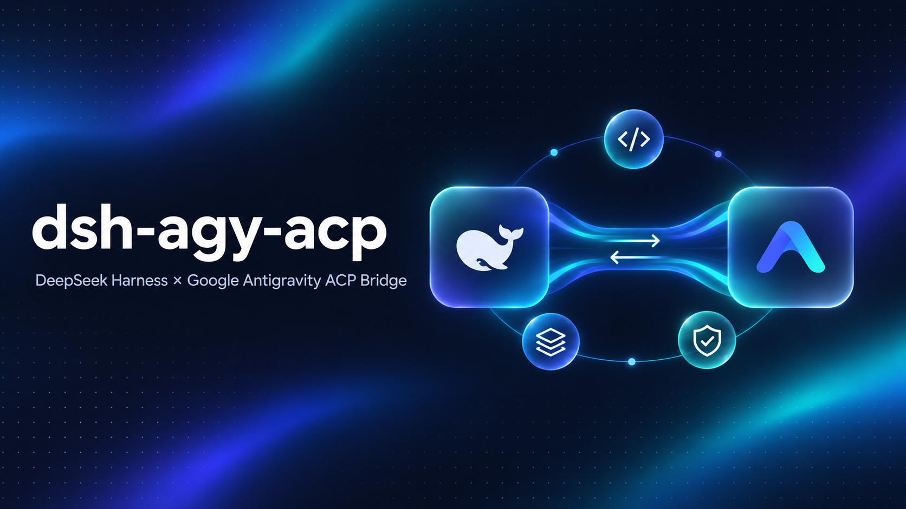
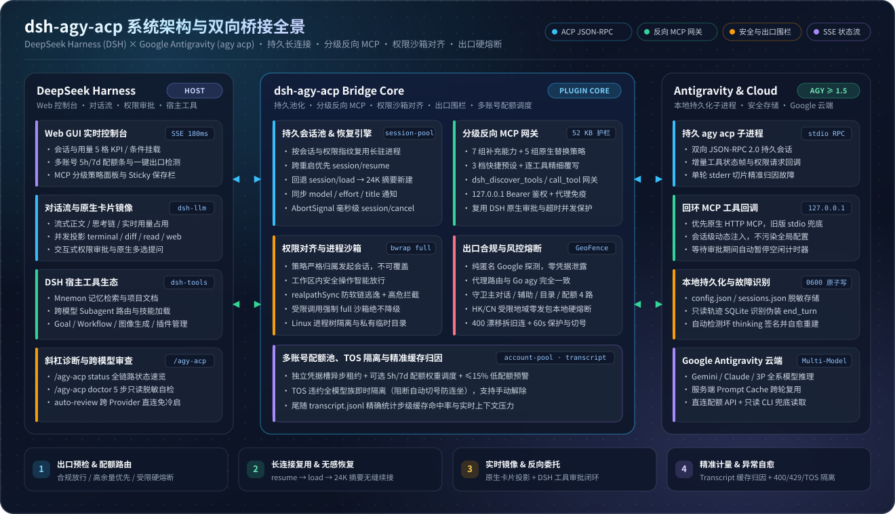
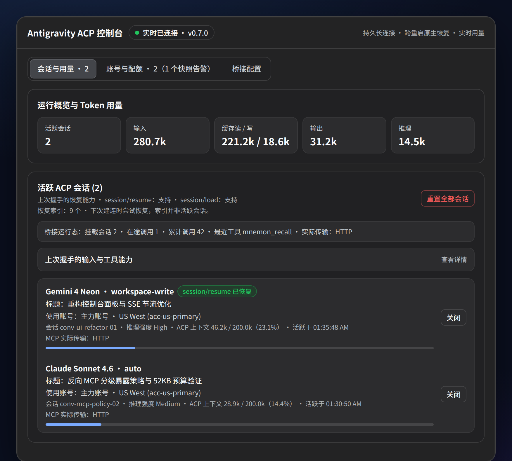
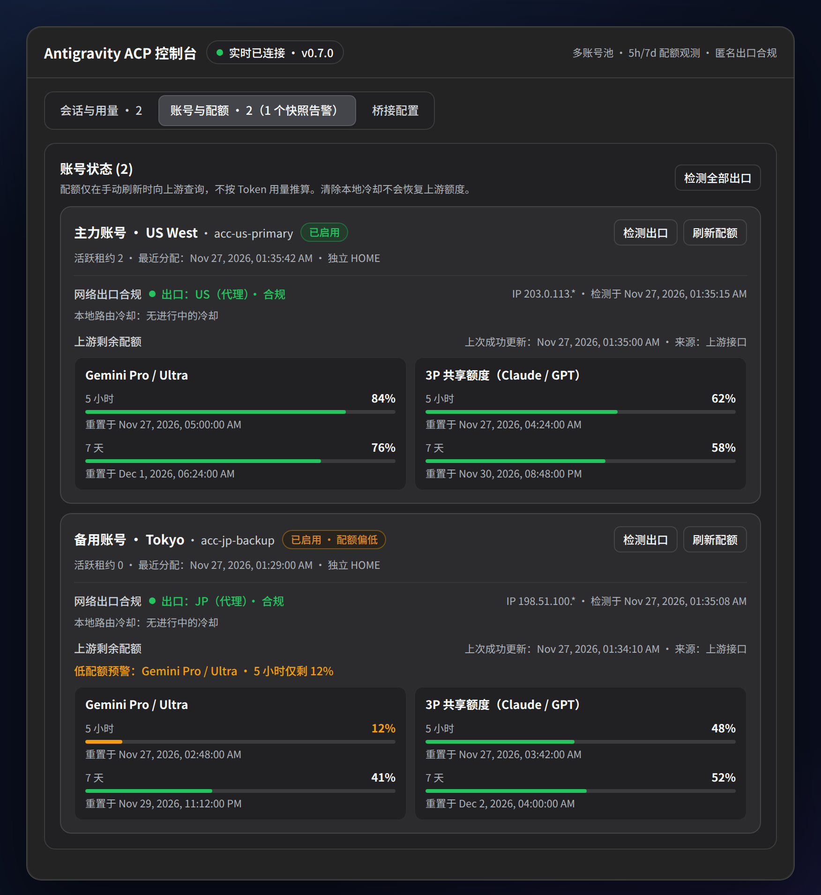
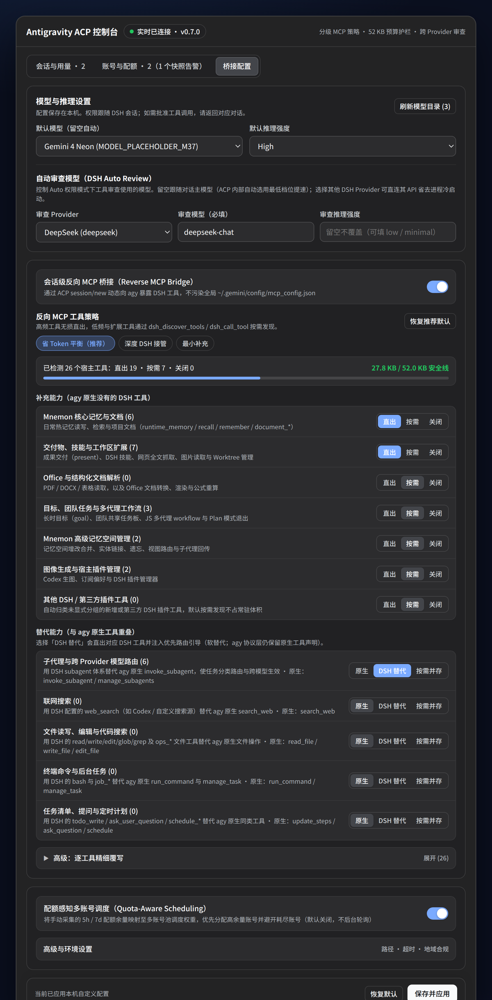

<div align="center">



# dsh-agy-acp

**新一代 DeepSeek Harness (DSH) × Google Antigravity (`agy acp`) 持久长连接桥接插件**

[English](README.md) · **简体中文**

[](https://www.npmjs.com/package/@morsewayne/dsh-agy-acp)
[](https://nodejs.org/)
[](#快速开始)
[](package.json)

持久 ACP JSON-RPC 2.0 长连接 · 分级反向 MCP 网关 · 原生工具卡片实时镜像 · 进程沙箱权限对齐 · 纯匿名出口合规硬熔断 · 多账号 5h/7d 配额调度

[快速开始](#快速开始) · [系统架构](#系统架构) · [控制台预览](#控制台预览) · [核心能力](#核心能力) · [权限与安全不变量](#权限与安全不变量) · [诊断与排查](#诊断与排查)

</div>

---

## 为什么选择 `dsh-agy-acp`

| 维度 | 核心亮点 |
| --- | --- |
| **零冷启动长连接** | 按 DSH 会话与权限指纹池化长驻 `agy acp` 进程；跨空闲与重启优先 `session/resume` → `session/load` → 24K 摘要重建，最大程度保留服务端 Prompt Cache。 |
| **分级反向 MCP 网关** | 内置 **7 组补充能力 + 5 组原生替换**策略、3 档快捷预设与 `dsh_discover_tools` / `dsh_call_tool` 按需元工具网关，配合 **52 KB 预算安全网**，在远低于 `agy acp` 64 KiB 上限的同时无缝复用 DSH 记忆、子代理、文档、工作流与原生审批。 |
| **原生对话工具卡片与精准缓存计量** | 注册 DSH 原生 `tool.call.toolview` 渲染器，直接以 `ReadBlock`（可点击文件/行号）、`DiffBlock`（`+N -M` 变更统计）、`TerminalBlock`（清理输出与退出码徽章）、`SearchBlock`、`WebBlock` 与任务清单呈现每一步工具调用（兼容实时与历史回放）；增量尾随 `transcript.jsonl` 精确还原每步缓存命中率与实时上下文占用。 |
| **纯匿名出口合规硬熔断** | 零第三方 IP 服务依赖，直接通过匿名 Google 端点与 Go `agy` 同源代理路由探测出口；受限地域（如 `HK` / `CN`）在本地 **零发包硬熔断**，漏网 `400` 即时拆旧连并自动切号。 |
| **多账号配额观测与 TOS 隔离** | 支持 5 小时 / 7 天双窗口配额可视化、可选配额权重调度与 ≤15% 低配额预警；命中 `TOS_VIOLATION` 即刻全模型族隔离并阻断自动故障转移，防止连锁风控。 |
| **低开销 DSH 原生控制台与安全门禁** | 后端按需监听 + 180ms SSE 合并节流 + 工具目录缓存，所有 HTTP/SSE 路由均经过 DSH `connection.requestRejection` 同源与登录认证校验；前端条件挂载与浅/深色 `--dsw-alias-*` 主题原生融合。 |

---

## 系统架构

<p align="center">
  
</p>

<details>
<summary>查看核心源码模块布局</summary>

```text
src/
├── index.ts                  # 插件入口、HTTP/SSE 挂载、工具目录缓存与生命周期协调
├── acp/                      # 持久 agy acp JSON-RPC 2.0 客户端、进程树与单轮 stderr 切片
├── common/                   # 配置常量、分级 MCP 工具策略 (mcp-tool-policy.ts)、地域与共享类型
├── mcp/                      # 会话级回环 HTTP/stdio 反向 MCP 服务端与按需元工具网关
├── provider/                 # DSH LLM Provider 适配器、工具镜像聚合、Transcript 用量尾随与自动审查路由
├── runtime/                  # 会话池、session/resume 索引、出口合规围栏、多账号配额池、TOS 隔离与 /agy-acp doctor
├── transport/                # SSE 广播节流器与受 DSH 访问门禁保护的控制台 REST API
└── client/                   # DSH Web 控制台 UI（会话与用量 / 账号与配额 / 桥接配置与 MCP 策略面板）
```

</details>

---

## 控制台预览

插件深度集成至 DSH Web 顶栏状态胶囊与设置面板，完整适配浅色 / 深色主题（`--dsw-alias-*`）。

### 1. 会话与用量监控
实时呈现活跃会话数、可恢复索引、反向 MCP 调用统计、累计输入/输出/缓存命中率、协商能力胶囊，以及每个会话的实际恢复方式（`session/resume` / `session/load` / 新建）、MCP 传输通道与上下文占用进度。

<p align="center">
  
</p>

### 2. 多账号池、出口合规与 5h/7d 配额观测
支持一键检测全部启用账号的代理出口合规状态，展示 5 小时 / 7 天双列可视化配额进度条、≤15% 低配额提醒、冷却倒计时与 TOS 隔离手动解除。

<p align="center">
  
</p>

### 3. 桥接配置、自动审查路由与反向 MCP 分级策略
高频设置与高级运维项分层组织：支持默认模型/推理强度配置、跨 Provider 自动审查转发、**省 Token 平衡 / 深度 DSH 接管 / 最小补充**一键预设、实时 **52 KB 字节预算仪表**、12 组三段式策略分段器、受控展开逐工具精细覆写，以及防误操作的底部 Sticky 保存栏。

<p align="center">
  
</p>

---

## 快速开始

### 环境要求
- **Node.js `>= 24`**
- 已安装并完成登录的 Antigravity CLI（**`agy >= 1.5`**）

### 从 npm 安装

```bash
dsh plugin --profile web add @morsewayne/dsh-agy-acp --registry=https://registry.npmjs.org
```

### 本地源码联调

先执行构建，再通过 DSH 插件管理器直接安装本项目目录（无需手动打包 `.tgz`）：

```bash
pnpm install
pnpm run verify
npm run build
# 打开 DSH Web → 插件管理 → 安装本地项目目录
```

启动或重启 `dsh web` 后，在任意聊天框输入：
- `/agy-acp`（或 `/agy-acp status`）：查看活跃连接、恢复索引、反向 MCP 统计、出口合规与 Token 概览
- `/agy-acp doctor`：执行 5 步只读、沙箱隔离且自动脱敏的环境自检

---

## 核心能力

### 1. 持久 `agy acp` 长连接与会话原生连续性
- **会话池化与实时协议同步**（`src/acp/`、`src/runtime/session-pool.ts`）：按 DSH 会话与权限指纹复用长驻子进程，实时消费 `config_option_update` 与 `session_info_update`，支持 `AbortSignal` 毫秒级 `session/cancel`。
- **三级无感恢复**（`src/runtime/session-index.ts`）：轻量索引原子持久化于 `~/.dsh/agy-acp/sessions.json`（`0600` 权限，上限 200 条、7 天过期，**绝不落盘对话正文或凭据**）。空闲回收或 DSH 重启后按能力协商依次尝试 `session/resume` → `session/load`（保留元数据而不重放历史）→ `session/new` + 24K 预算 `<prior_conversation_digest>`。
- **跨 Provider 自动审查路由**：通过 `autoReviewProvider` / `autoReviewModel` / `autoReviewEffort` 可将 DSH 的 `purpose: 'auto-review'` 请求直连转发到任意已注册 DSH Provider（零 `agy acp` 冷启动），或在指定 Antigravity 模型上以自动最低推理档位执行；所有辅助调用均运行在独立只读沙箱中，不污染主会话池。

### 2. 分级反向 MCP 网关与原生委托
- **紧凑常驻 + 按需发现**（`src/common/mcp-tool-policy.ts`、`src/mcp/server.ts`）：
  - **7 组补充能力**：核心记忆（`memory_core`）与交付技能（`delivery_skills`）默认常驻直出；文档办公、目标工作流、记忆管理、图像系统等低频扩展默认按需加载。
  - **5 组原生替换**：子代理（`subagents`）默认由 DSH 替代以保留宿主的跨模型路由策略；联网搜索、文件读写、终端任务、计划定时默认保留 `agy` 原生实现，可一键切换为「由 DSH 替代」或「按需并存」。
  - **元工具网关 & 52 KB 安全网**：低频工具通过 `dsh_discover_tools` + `dsh_call_tool` 按需查询完整 schema 与执行调用，复用 DSH 原生审批卡片并在等待审批期间自动暂停 ACP 空闲超时；若自定义常驻配置超限，52 KB 预算安全网会自动降级兜底并告警。
- **回环传输与代理免疫**：优先使用原生回环 HTTP MCP（`127.0.0.1` + 会话级 Bearer 鉴权，旧版自动回退 stdio），不污染全局 `~/.gemini/config/mcp_config.json`；内置代理环境变量免疫、`NO_PROXY` 回环加固、单调用超时中止（`-32001`）与单会话并发上限（`-32005`）。

### 3. 原生对话工具卡片渲染与精准缓存计量
- **DSH 原生 `tool.call.toolview` 渲染**（`src/provider/mirror-tool.ts`、`src/client/mirror-tool-view.ts`）：工具进入 `in_progress` 即并发推送状态更新，直接复用 DSH Web 原生组件将 `agy_acp_tool` 渲染为可读的步级卡片（含 Read 可点击文件行号、Edit/Write 的 `+N -M` 差异块、Terminal 退出码徽章、Grep/Glob 搜索、Web 检索抓取与 `update_steps` 清单），同时支持实时流与历史会话回放。
- **Transcript 步级用量归因**：直接增量尾随账号目录下的 `transcript.jsonl`（`PLANNER_RESPONSE` 记录），在每个工具边界准确上报实时上下文压力与真实缓存命中率；无 transcript 时平滑回退到按比例缩放的占用估算。

### 4. 纯匿名出口合规探测与防风控熔断（GeoFence Guard）
- **零第三方依赖纯匿名探测**（`src/runtime/egress-guard.ts`）：直接探测 `HEAD https://aistudio.google.com/` 与匿名 `POST https://daily-cloudcode-pa.googleapis.com/v1internal:loadCodeAssist`，不发送任何凭据，严格对齐 Go `agy` 的代理路由规则（`NO_PROXY` → `HTTPS_PROXY` → `ALL_PROXY` → `HTTP_PROXY`），原生支持 HTTP `CONNECT`、SOCKS5/SOCKS5H（`ATYP=0x03` 远端解析防 DNS 泄露）及直连/TUN，完美适配 Clash Verge 等分流代理。
- **4 链路统一守门与漏网 400 瞬时熔断**：覆盖主对话（新建与长连接复用）、辅助调用、模型目录探测与配额查询。支持 `block`（默认）/ `strict` / `warn` / `off` 四档策略；一旦代理漂移触发上游 `400 FAILED_PRECONDITION`，立即销毁旧子进程（释放固定 Go HTTP/2 连接）、触发 60 秒本地熔断并保留 `SessionIndex` 供多账号无缝切号恢复。

### 5. 多账号配额池、隐藏异常识别与 TOS 隔离
- **独立凭据槽与配额权重调度**（`src/runtime/account-pool.ts`、`src/runtime/account-quota.ts`）：非阻塞异步凭据槽租约，支持直连上游配额接口 + 只读 CLI 兜底，开启「配额感知调度」后优先分配高余量账号。
- **隐藏异常与 TOS 保护**：通过只读 SQLite 轨迹步骤识别伪装成 `end_turn` 的上游错误（`400` / `429` / `TOS_VIOLATION` / `INVALID_THINKING_SIGNATURE`）。命中 `TOS_VIOLATION` 时以最高优先级隔离全模型族并阻断自动故障转移，避免牵连池内其他账号。

---

## 权限与安全不变量

权限策略始终归属发起请求的 DSH 会话（旧 `permissionMode` 已废弃，HTTP 接口不可覆盖会话权限）：

| DSH 主会话权限 | `agy acp` 执行边界与审批策略 |
| --- | --- |
| **仅可查看** | 进程启动即进入 DSH 只读文件沙箱；仅放行读/搜索类回调，修改、命令和未知请求一律拒绝。 |
| **工作区内修改** | 运行在会话级 `full` 工作区进程沙箱内。经路径归一化与 `realpathSync` 防软链逃逸校验的工作区编辑/删除/移动及常规终端命令智能放行；命中高危命令护栏（提权、危险删除、`git push`/`reset --hard`/`clean -f`、远端脚本、外网上传、凭据读取、发包/部署等）、超长/未知命令或越界路径时升级交由 DSH 人工审批。 |
| **自动审查** | CLI 与账号支持原生 `auto` 时启用之，仍上报的请求交由 DSH；不支持时严格使用 `default` 交由 DSH 审批，绝不静默降级为自动同意。 |
| **完全权限** | 不附加文件沙箱，但保留 ACP 权限回调通道，仅单次放行当次操作，绝不写入 `always allow`。 |

> **强沙箱与访问门禁不变量**：
> - 所有受限模式调用（模型目录探测、辅助调用、配额查询、`/agy-acp doctor`）要求宿主 `sandbox.confine` 返回 `enforcement === 'full'`；不满足时直接拒绝启动，绝不无沙箱降级执行。
> - 所有 `/plugins/agy-acp/*` HTTP 与 SSE 路由均绑定 DSH 宿主 `connection` 服务并在入口强制校验 `connection.requestRejection(req)`（Host/Origin 信任围栏 + 浏览器认证 Cookie），同时要求所有 `POST` 请求使用 `application/json` 且响应声明 `Cache-Control: no-store`。

---

## 诊断与排查

### 控制台与运行时说明
- **配置持久化**：控制台白名单配置原子写入 `~/.dsh/agy-acp/config.json`（`0600`），支持一键「放弃修改」与二次确认「恢复默认」；多账号敏感目录与代理环境变量（`accounts`、`credentialSlotDir`）仅由宿主配置只读管理。
- **超时语义**：`requestTimeoutMs` 对 `session/prompt` 表示**活跃空闲超时**而非整轮硬上限；有效模型输出与工具进展会重置计时，等待人工审批、长耗时反向 MCP 工具与主动取消均有独立生命周期处理。
- **配额与隔离边界**：仅针对明确归属隔离账号且未过期的文件凭据尝试直连配额 API（不续签 OAuth、不读取机器默认共享令牌）；`3P` 为共享额度，满额滚动窗口的占位时间不会被误判为真实倒计时。插件仅清理可核实归属的私有临时目录，不触碰真实 HOME 中的共享会话数据库或规则目录。
- **异常自愈**：若检测到已损坏的 `thinking` 签名，插件会自动作废对应会话索引并在下轮以摘要重建，不会盲目重跑已执行过的工具；SSE 断连时控制台会明确提示当前展示的是最后快照。

---

## 开发、验证与发布

```bash
# 安装依赖
pnpm install

# 全量校验：架构依赖检查 + TypeScript 类型检查 + tsdown 构建 + 全套单元测试
pnpm run verify
```

在准备发布的 `main` 分支执行以下命令，GitHub Actions 将自动校验标签、运行 `pnpm run verify` 并发布至 npm：

```bash
npm version patch   # 或 minor / major
git push --atomic origin main "v$(node -p "require('./package.json').version")"
```

## License

[MIT](package.json) · Third-party notices in [THIRD-PARTY-NOTICES.md](THIRD-PARTY-NOTICES.md)
